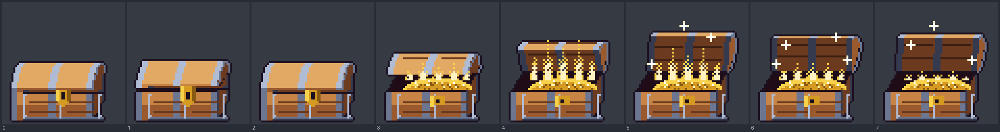

# AI Game Art Studio

[简体中文](README.zh-CN.md)

A local-first studio for 2D game art — pixel art and HD illustration. Self-contained Python app (Pillow + numpy),
English and Chinese UI, no cloud service, database or paid API required.

| Engine | What it does |
|---|---|
| **A — Pixel engine** | Layered, replayable procedural pixel art: items, icons, effects, tiles. Own engine with an Atelier-compatible call format. |
| **B — AI generation** | Reference-driven character keyframes through **ComfyUI** (any model/workflow you import). Codex optional. |
| **C — External assets** | Import PNG / sequences / sprite sheets / GIF / APNG / MP4 / WebM; key backgrounds, slice, align. |



## Install & launch

Requirements: **Python 3.10+**. Optional: **ffmpeg** (video import), **ComfyUI** (AI generation).

```powershell
# Windows
powershell -ExecutionPolicy Bypass -File .\start.ps1      # creates .venv, installs, opens http://127.0.0.1:8870
```
```bash
# Linux / macOS
./start.sh                                                # --port 8870 --workspace DIR --comfy http://127.0.0.1:8188
```

Manual: `python -m venv .venv`, `.venv/bin/pip install -r requirements.txt`, `.venv/bin/python -m artstudio serve`.
Language: switch English/中文 in the top bar. CLI messages: `--lang zh-CN` or `ARTSTUDIO_LANG=zh-CN`.
Config: `studio.config.example.json`, `.env.example`. Windows + ComfyUI guide: [docs/deployment-windows.md](docs/deployment-windows.md).

## Workspaces

| Workspace | Functions |
|---|---|
| Library | projects, characters, assets, filters, prompt language, knight sample |
| Character Studio | identity fields, side/4/8 directions, candidates → approved **locked** masters, explicit replace/unlock, optional mirroring, history |
| Animation Studio | playback, FPS, per-frame durations, loop, onion skin, ground line, pivot editing, comparison, reorder/duplicate/delete, replace, selective regeneration, events, effect layers, QA, review, versions |
| Procedural Studio | run builders, replay `.recipe`, inspect documents (palette, layers, cels, calls) |
| Import & Processing | drag-and-drop import, slicing, background removal, de-pixelation, group alignment, before/after |
| Generation | provider status, ComfyUI workflow import/check, keyframe generation, prompt preview, budgeted batches |
| Export Studio | PNG frames, sheets, packed atlas, GIF/APNG, JSON, Cocos Creator plist, Phaser/PixiJS JSON, Godot helper, ZIP |

## CLI (JSON output, for agents)

```bash
python -m artstudio project create "My RPG" --id my-rpg
python -m artstudio procedural ice_spear --project my-rpg --params '{"element":"lightning"}'
python -m artstudio draw my_gem.jsonl --project my-rpg --name "Red Gem" --type icon
python -m artstudio import hero_walk.png --project my-rpg --opts '{"slicing":{"method":"grid","cols":8,"rows":1},"background":{"method":"auto"}}'
python -m artstudio generate --project my-rpg --provider comfyui --workflow sd-image-to-image --character hero --template walk --direction east --params '{"checkpoint":"<file>.safetensors"}'
python -m artstudio export --project my-rpg --assets <ids…> --formats atlas cocos gif json zip
```

New procedural assets: **[docs/engine-a-guide.md](docs/engine-a-guide.md)** · agent rules: [AGENTS.md](AGENTS.md) · skills: [skills/](skills).

## Verification status

- ✅ Offline (Stage A): 63 automated tests (engine, pipeline, encoding, ComfyUI mock, server, CLI), Playwright UI test in
  English and Chinese, proof-of-concept build — see [DEVELOPMENT_PROGRESS.md](DEVELOPMENT_PROGRESS.md).
- 🧪 AI generation is **mock-tested only**. ⛔ **Stage B (real ComfyUI inference) has not been run.**

## Layout

```
artstudio/    app: engine (Engine A), pipeline (spritepipe), providers, processing, qa, export, server, web, schemas, builders
samples/      knight sample art (demonstration only — see samples/knight/NOTICE.md)
mock_comfyui/ offline ComfyUI API simulator (labelled test fixtures)
workflows/    bundled ComfyUI templates · skills/ agent skills · examples/ Cocos Creator TS, Godot script
demo/         proof-of-concept builder · deliverables/ POC outputs · docs/ · scripts/ · tests/
```

Licence: MIT. Derived code and sample data keep their original notices — [THIRD_PARTY_NOTICES.md](THIRD_PARTY_NOTICES.md).
