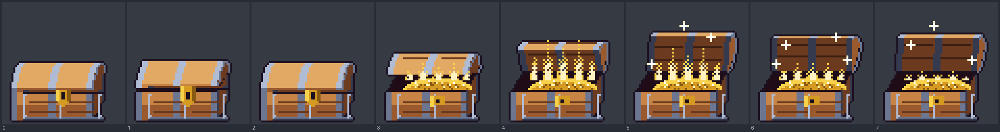

# AI 游戏美术工作室

[English](README.md) · 版本 **0.8.1**（[更新日志](CHANGELOG.md)）· MIT 许可

**本地优先的 2D 游戏美术制作工具**：支持像素风和高清插画，从单个图标到角色动画精灵，都能直接导出到游戏引擎。
纯 Python 应用（Pillow + numpy），网页界面支持中英文，不需要云服务、数据库或付费 API。



## 能做什么

工作室有三个工具，产出**同一种素材格式**，编辑、检查和导出对所有素材通用。

| 工具 | 适合制作 | 方式 |
|---|---|---|
| **🔥 像素工坊（Pixel Forge）** | 技能特效、道具、图标、物件、场景 | 内置像素生成器 + **实时编辑器**：样式、尺寸、速度、颜色、描边、光晕、翻转、放大。分层、可回放，离线可用，不需要 AI。 |
| **🎬 动作工作室（Motion Studio）** | 角色的动作帧：待机、行走、攻击、自定义动作 | 参考图（上传或用文字描述生成）→ 动作 → 每个动作一张精灵图表，由 **Codex CLI** 或本地 **ComfyUI** 绘制，本地切图、对齐、清理边缘；带像素级精灵编辑器。 |
| **📥 素材导入（Asset Import）** | 已有的美术资源 | PNG / 序列帧 / 精灵表 / GIF / APNG / MP4 / WebM：去背景、切图、对齐。 |

通用功能：

- **角色**：角色设定、横版 / 4 / 8 方向、候选 → 通过后**锁定**母版、历史记录。
- **动画编辑**：播放、帧率、逐帧时长、洋葱皮、锚点、排序 / 复制 / 替换帧、单帧重新生成、事件、特效图层、版本快照。
- **处理**：去背景、切图、还原像素、整组对齐（整组统一缩放、地面锚点、保留腾空帧、扩展画布而不裁掉武器）。
- **检查**：确定性检查（尺寸、裁切、背景、抖动）与视觉审核分开记录。
- **导出**：PNG 帧、精灵表、打包图集、GIF / APNG、JSON、**Cocos Creator** plist、Phaser / PixiJS JSON、Godot 辅助脚本、ZIP。
- **外观**：English / 中文，以及 跟随系统 / 深色 / 浅色 主题（顶栏）。

### 像素工坊内置生成器

| 生成器 | 产出 | 选项（编辑器另有速度 / 颜色 / 描边 / 光晕 / 翻转 / 放大） |
|---|---|---|
| `heal` | 治疗：地面光圈、光柱、上升的十字光点（循环） | `color` green/blue/gold、`frames` |
| `buff_aura` | 增益光环：脚下旋转光环、上升光束和箭头（循环） | `color` gold/red/purple、`frames` |
| `lightning_strike` | 落雷：闪电劈下、命中闪光、冲击环、火花 | `color` blue/purple/yellow、`thickness` 1–3 |
| `shield_barrier` | 护盾：六边形护罩形成、流光、消散（半透明） | `color` azure/gold/green |
| `frost_nova` | 冰霜新星：中心闪光、向外扩散的冰刺环、雪花 | `color` ice/arcane/toxic |
| `poison_cloud` | 毒云：翻滚的毒雾、冒泡和滴落（循环） | `color` green/purple/orange、`frames` |
| `fireball` | 循环火球 | `size`、`frames` |
| `sword_slash` | 8 帧剑气 | `color` azure/gold/crimson、`thickness` 0.5–1.6 |
| `ice_spear` | 圆形技能图标 | `size`、`element` ice/lightning/poison |
| `potion` | 奇幻药水瓶（道具） | `size`、`frames`、`liquid` 红/蓝/绿/紫 |
| `chest` / `chest_open` | 宝箱；8 帧开箱动画 | `size` |
| `hero_shrine` | 96×96 英雄神殿，火盆带动画 | `frames`、`banner` red/blue/green |


**战棋 / 地牢用的俯视方格技能**（v0.6）：画布宽 = `tiles × 32`，**底部 `tiles×32` 的正方形就是地面格子**，上方留出火焰、
光柱用的空间；锚点在格子中心。

| 生成器 | 产出 | 选项 |
|---|---|---|
| `lava_burn` | **熔岩灼地**：地面龟裂发光 → 岩浆涌出淹没格子 → 持续燃烧（循环）→ 冷却成焦岩。标签 cast / burn / fade | `tiles` 1–5、`color` lava/soulfire/acid、`phase` all/cast/burn/fade |
| `meteor` | 陨石坠落：警示圈、燃烧陨石落下、火焰爆炸、冒烟陨坑 | `tiles`、`color` fire/arcane/frost |
| `fire_pillar` | 火柱：符文圈 → 火柱冲天（循环）→ 火星 | `tiles` 1–3、`color` fire/azure/violet |
| `earth_spike` | 地刺：每格岩刺破土、尘环、崩碎 | `tiles`、`color` earth/crystal/ice |
| `whirlpool` | 漩涡（循环） | `tiles`、`frames`、`color` water/abyss/sand |
| `gale` | 龙卷风暴（循环） | `tiles` 1–3、`frames`、`color` wind/sand/storm |
| `ice_field` | 冰封大地：寒霜蔓延、冰晶、闪光（循环）、碎裂 | `tiles`、`color` ice/crystal |
| `holy_judgment` | 圣光审判：魔法阵、光柱、十字闪光 | `tiles`、`color` holy/sun/moon |
| `dark_vortex` | 暗黑诅咒之地（循环） | `tiles`、`frames`、`color` dark/blood/void |
| `life_drain` | 生命汲取：精华螺旋升入光球后飞走 | `tiles` 1–3、`color` blood/soul/mana |

**日式 RPG 图标**（v0.6，32 / 48 / 64 像素，默认 48；逐像素光照；可选稀有度边框 common … legendary）：

| 生成器 | 种类 | 变体 |
|---|---|---|
| `weapon_icon` | 剑、太刀、匕首、斧、枪、法杖、弓、锤 | `material` 档次：青铜（朴素）→ 铁（血槽、护手）→ 秘银（符文、宝石）→ 金（华丽、翼形）→ 暗黑（锯齿、尖角）—— **造型不同**，不只是换色 |
| `armor_icon` | 头盔、铠甲、盾、护手、靴、披风、戒指、护符 | `material` 同上（皮帽→骑士盔→翼盔→王冠盔→角盔……） |
| `consumable_icon` | HP 药水、MP 以太、解毒剂、万能药、凤凰之羽、卷轴、炸弹、饭团 | `grade` 小 / 中 / 大：瓶型、羽毛数、封蜡等不同 |
| `material_icon` | 矿石、锭、宝石、魔晶、草药、蘑菇、钥匙、钱袋 | `color` 6 种，每种独立设计（宝石切工、草药、蘑菇、钥匙柄……） |
| `skill_icon` | 18 个技能图标 | `element` 自动或指定边框元素 |
| `status_icon` | 16×16 状态：攻防速魔 ↑↓ 与各种异常 | — |

**界面套件**（v0.6，4 种主题：经典蓝窗 / 木框金边 / 石材铁框 / 羊皮纸，支持九宫格）：

| 生成器 | 内容 |
|---|---|
| `ui_panel` | 窗口、对话框（名字牌 + 跳动的下一页箭头）、提示框、标题横幅、分页标签（选中 / 未选中） |
| `ui_button` | 长条 / 方形 / 圆形按钮，4 帧：普通 / 悬停 / 按下 / 禁用 |
| `ui_bar` | HP / MP / EXP / 体力 / ATB 条，`fill` 0–1，`part` 可单独导出边框或填充 |
| `ui_frame` | 头像框、物品格、技能格（普通 / 选中 / 锁定） |
| `ui_icon` | 20 个菜单图标：背包、装备、技能、地图、任务、商店、设置、存档、主页、邮件、战斗、自动、倍速、确认、关闭、返回、金币、宝石、体力、手指光标；`style` 彩色 / 白色 |

一次导出全部变体：`python scripts/make_jrpg_pack.py --out deliverables/jrpg_pack`（PNG、精灵条、GIF、预览图、`meta.json`）。
**角色套装**（v0.7，`character_kit`，图库分组「角色」）：64×64 四方向基础角色，在每一帧上程序绘制纸娃娃式装扮，衣服、头发、头饰和武器跟随动作。

| 职业 | 头部 | 身体 | 武器 |
|---|---|---|---|
| `base` | —（原版 Craftpix 基底；`base` 选男 / 女） | — | 剑 |
| `knight` 骑士 | 钢盔（帽檐、护鼻、护颊、中脊） | 板甲 + 护肩、红色罩袍、腰带、红披风 | 钢剑 |
| `mage` 法师 | 紫色巫师帽（帽檐、金带、弯尖）、紫色长发 | 蓝色星纹长袍、红腰带 | 蓝宝珠法杖；攻击 = **施法** |
| `ranger` 游侠 | 绿色兜帽（盖住头部，后有尖尾，垂到肩上） | 皮背心 + 腰带 + 绿斗篷 | 短剑；**弓箭射击** |
| `priest` 牧师 | 白兜帽 + 金十字主教冠 | 白袍、金色圣带、短披肩 | 金色十字杖；攻击 = **施法**（圣光金色） |
| `berserker` 狂战士 | 角盔 | 毛皮护肩 + 皮甲 | 斧 |
| `necromancer` 死灵法师 | 黑兜帽、脸藏在阴影里、绿色发光眼睛 | 骨刺领、骷髅护肩、破烂的暗紫长袍 + 黑披风 | 骷髅头法杖；攻击 = **施法**（绿色） |
| `skeleton` 骷髅兵 | 骷髅头（大黑眼窝、发光瞳孔、牙齿、颅骨裂纹、收窄的太阳穴和下颌） | 镂空：躯干只是一根脊椎杆 + 锁骨和骨盆横杆，四肢都是细骨头；动作僵硬、卡顿、迟缓 | 旧铁剑 + 包金属边的小木圆盾；**`Summon_Rise` 召唤破土** |

参数：`action` = 素材包的 13 个动作（空手 / 持剑 × 待机、行走、奔跑、受击、倒地，挥剑攻击、边走边砍、边跑边砍）**+ `Bow_Attack` 弓箭射击**（基于挥剑的身体姿势合成：搭箭 → 拉弓 → 放箭 → 收势；侧面重画手臂，弓弦由拉弦手拉开）**+ `Cast_Spell` 施法**（法杖竖握：脚下法阵 → 光点聚集 → 举杖、杖头发光 → 爆发 / 飞弹 → 收势；法师、牧师、死灵法师的 `Sword_Attack` 自动播放施法）**+ `Summon_Rise` 召唤破土**（在死灵法阵里从地下爬出，给骷髅兵用）；`facing` 正面 / 左 / 右 / 背面；`base` 自动 / 男 / 女。图层：影子、后层、身体、装备、前层、受击闪红——右手持武器时，近侧武器画在脸前。轴心 = 脚底 (32, 44)；待机 / 行走 / 奔跑循环播放。

> **基础美术不在仓库里。** 它是 Craftpix 免费的 *Base 4-Direction Male / Female Character* 素材包，许可允许用于游戏，但不允许再分发。请从 craftpix.net 下载两个 zip，然后运行 `python scripts/setup_character_base.py <男.zip> <女.zip>`（解压到被 git 忽略的 `assets_local/`；也可以设置 `ARTSTUDIO_CHARKIT_DIR`）。`python scripts/make_character_pack.py` 把所有职业 × 动作导出为精灵表（行 = 正面、左、右、背面）、GIF 预览和 `meta.json`，输出到 `assets_local/character_pack/`。

新素材不一定要写代码：Agent 可以写一个调用列表，用 `artstudio draw` 运行。见
[docs/pixel-forge-guide.md](docs/pixel-forge-guide.md)（英文，供 Agent 使用）。

## 快速开始

需要 **Python 3.10+**。可选：**ffmpeg**（视频导入）、**ComfyUI**（AI 生成）。

```powershell
# Windows
powershell -ExecutionPolicy Bypass -File .\start.ps1      # 自动创建 .venv、安装依赖并打开 http://127.0.0.1:8870
```
```bash
# Linux / macOS
./start.sh
```

## 使用方法

### 网页工作室（http://127.0.0.1:8870）

首页有三个入口，对应三个工具。

**🎬 动作工作室** —— 角色动作帧流水线：

1. **角色**：上传 **一张参考图**，或者 **用文字描述角色**，让 Codex / ComfyUI 画 4 张候选，挑一张。选中的图会锁定为参考图，之后所有动作都以它为准。
2. **动作**：**★ 核心三件套** 一键加入行走（8 帧）、攻击（8 帧）、受击（4 帧）；也可以选其它预设或用一句话描述自定义动作。每个动作按固定网格画成一张图（8 帧 → 4×2，4 帧 → 2×2）。
3. **提示词**：**✨ 用 Codex 编写** 会查看参考图，写出角色描述、逐帧姿势和提示词；也可以使用内置模板。所有内容都可以修改。
4. **生成**（▶ 运行流水线）：选择 **Codex CLI** 或 **本地 ComfyUI**，动作按队列依次运行。每张图会切成单帧，整张统一缩放到 **角色高度**（默认 64 像素），对齐同一条地面线，颜色锁定到参考图调色板并清理边缘。检查不合格会 **自动重画**（默认最多 2 次）。
5. **检查与导出**：预览每个动作，用 **✎ 编辑像素** 打开精灵编辑器，单帧重做，按新高度重新切图，审核后导出到 Cocos Creator、Godot、Phaser/PixiJS 或 PNG/GIF。

**✎ 精灵编辑器** —— 点任意像素查看颜色并修改、删除，或把这个颜色在本帧 / 整个动画里替换；铅笔、橡皮、吸管、油漆桶、直线、矩形、框选（移动 / 复制 / 粘贴 / 翻转）、镜像、洋葱皮、播放、复制 / 移动 / 删除帧、撤销 / 重做。手改像素存成修补层，重新处理动作也会保留。快捷键：P B E I G L R M（工具），方向键 + Enter / Delete（单个像素），Ctrl+Z / Ctrl+S，, 和 .（切换帧）。

**🔥 像素工坊** —— 左侧选择生成器，中间实时预览，右侧调整：

| 区域 | 可调内容 |
|---|---|
| 样式 | 生成器自带选项（配色、尺寸、帧数、粗细……） |
| 节奏 | 速度 0.25×–3×、循环 |
| 颜色 | 单独修改调色板中的任意颜色，或整体调整色相 / 饱和度 / 亮度 |
| 描边与光晕 | 描边 0–3 像素及颜色、抖动光晕 0–4 像素及颜色、水平翻转、输出放大 1×–4× |
| 保存 | 保存到资源库，或保存并导出（PNG 帧、精灵表、GIF、JSON、Cocos、ZIP） |

所有修改都会随素材保存，并记录为像素引擎调用，因此保存的素材可以精确回放，也能在工坊中重新打开（「本项目已保存」）。

**📥 素材导入** —— 拖入文件，选择切图 / 去背景 / 对齐方式后导入。

专业工具在 **更多工具** 中：逐帧 **动画编辑器**、**角色详情**、**生成与工作流**（ComfyUI）和 **像素文档**（配方、图层、图格）。

- **界面语言**：顶栏切换 English / 简体中文（记住选择；首次按浏览器语言）。
- **中文/GBK 系统**：所有读写均为 UTF-8，GBK/cp936/cp1252 系统下不会出现编码错误。

### 命令行（JSON 输出，便于脚本和 Agent 调用）

```bash
python -m artstudio --lang zh-CN project create "我的 RPG" --id my-rpg
python -m artstudio builders                                       # 列出生成器和动画模板
python -m artstudio procedural hero_shrine --project my-rpg --params '{"banner":"blue"}'
python -m artstudio procedural heal --project my-rpg --params '{"color":"gold"}' --edits '{"speed":1.5,"outline":1,"glow":2}'
# 动作工作室（角色动画）
python -m artstudio animate new --project my-rpg --name "火焰骑士" --image knight.png --view side
#   ……或者用文字描述：生成 4 张候选，再锁定一张
python -m artstudio animate describe --project my-rpg --name "火焰骑士" --description "Q版骑士，红披风，大剑" --provider codex
python -m artstudio animate pick --project my-rpg --character <角色ID> --candidate <候选ID>
python -m artstudio animate core --project my-rpg --character <角色ID>                   # 行走 + 攻击 + 受击
python -m artstudio animate add --project my-rpg --character <角色ID> --preset attack
python -m artstudio animate add --project my-rpg --character <角色ID> --name "旋风斩" --description "伸剑原地转一圈" --frames 6
python -m artstudio animate prompts --project my-rpg --character <角色ID> --method codex --language zh-CN
python -m artstudio animate generate --project my-rpg --character <角色ID> --provider codex --height 64 --retries 2
python -m artstudio draw my_gem.jsonl --project my-rpg --name "红宝石" --type icon
python -m artstudio generate --project my-rpg --provider comfyui --workflow sd-image-to-image --character hero --template walk --direction east --prompt-language zh-CN --params '{"checkpoint":"<文件>.safetensors"}'
python -m artstudio export --project my-rpg --assets <素材ID…> --formats atlas cocos gif json zip
```

- 命令行提示语言：`--lang zh-CN` 或环境变量 `ARTSTUDIO_LANG=zh-CN`。
- 配置：`studio.config.example.json`、`.env.example`。Codex CLI：安装并运行 `codex login`，工作室会在 PATH 中找到它（或设置 `codex_bin`）。
- Windows 与 ComfyUI 部署：[docs/deployment-windows.zh-CN.md](docs/deployment-windows.zh-CN.md)。

### 内置 ComfyUI 工作流模板

`workflows/comfyui/`：文生图、图生图、角色参考、姿势关键帧、局部重绘、SVD 图生视频、去背景（rembg）。
在真实 ComfyUI 上测试前（阶段 B）均为**未验证**。也可以在界面或命令行导入自己的工作流。

## 基于哪些项目

本仓库是独立的，不包含其他项目的 git 仓库。它基于两个 MIT 项目：

| 上游项目 | 采用的内容 | 现在的位置 |
|---|---|---|
| **[Atelier](https://github.com/marmikshah/atelier)**（Marmik Shah），提交 `8ac6adf` | 工具调用格式、文档 / recipe 结构、绘制规则 | `artstudio/engine`：自研 Python 实现（不需要 Rust），Atelier 的 recipe 回放结果**逐像素一致**。 |
| **[Pixel Atelier](https://github.com/jinxingtaire/pixel-atelier)**（Pixel Character Pipeline contributors），提交 `15d199f` | 精灵处理流程、中文精灵表提示词、Codex 客户端、骑士示例 | `artstudio/pipeline/spritepipe.py`、`artstudio/prompts_zh_sheet.py`、`artstudio/providers/codex_rpc.py`、`samples/knight/`，已改写为 UTF-8，兼容 GBK/cp936 系统。 |

AI 生成通过 **[ComfyUI](https://github.com/comfyanonymous/ComfyUI)** 的服务器接口完成，不包含 ComfyUI 代码。
许可与派生文件清单：[THIRD_PARTY_NOTICES.md](THIRD_PARTY_NOTICES.md)。

## 验证状态

- ✅ **离线验收（阶段 A）**：107 项自动化测试（其中 5 项角色套装测试需要本地 Craftpix 素材包，没有时跳过）、覆盖完整引导流程的 Playwright 中英文界面测试、概念验证素材，见 [DEVELOPMENT_PROGRESS.md](DEVELOPMENT_PROGRESS.md)。
- 🧪 **AI 生成目前只经过模拟测试**：ComfyUI 使用 `mock_comfyui/`，Codex 使用测试替身（`tests/fake_codex.py`）。模拟输出标记为 TEST FIXTURE，不是 AI 作品。真实的 Codex CLI 尚未在此运行。
- ⛔ **阶段 B（真实 ComfyUI 推理）尚未运行**。请在 ComfyUI 电脑上运行 `scripts/production_smoke_test.py`。

## 参与开发

- 规则与注意事项：[AGENTS.md](AGENTS.md)；需求：[SPECIFICATION.md](SPECIFICATION.md)。
- 运行测试：`python scripts/run_tests.py`。
- 版本历史：[CHANGELOG.md](CHANGELOG.md)；当前版本：[VERSION](VERSION)。
